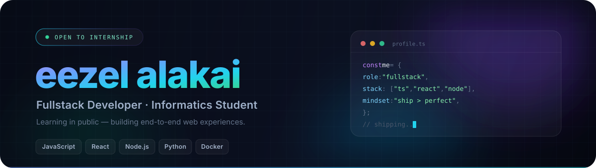

<!--
  ┌─────────────────────────────────────────────────────────────┐
  │  GitHub Profile README · Muhammad Haikal Aghista            │
  │  Banner & footer: SVG custom (assets/)                      │
  │  Panduan edit & deploy: SETUP.md                            │
  └─────────────────────────────────────────────────────────────┘
-->

   alt="Haikal Aghista — Fullstack Developer" width="100%" />

    

  
  
  
  

---

## <samp>❯ whoami</samp>

Informatics Engineering student who learns by building. I turn ideas into responsive interfaces, then wire them to a real backend.
Currently going deep into web development — one commit, one small win at a time.

- **Education** — Informatics Engineering, semester 3
- **Building** — [Portofolio Angkasa](https://alakaieezel.github.io/Portofolio/)
- **Learning** — React, Node.js, databases, Docker
- **Open to** — internship, freelance, collaboration

---

## <samp>❯ stack</samp>

  <picture>
    <source media="(prefers-color-scheme: dark)" srcset="https://skillicons.dev/icons?i=html,css,js,react,tailwind,git,github,vscode&theme=dark&perline=8" />
    
  </picture>

    

  <picture>
    <source media="(prefers-color-scheme: dark)" srcset="https://skillicons.dev/icons?i=nodejs,python,postgres,mongodb,docker,githubactions,npm,bash&theme=dark&perline=8" />
    
  </picture>

---

## <samp>❯ highlights</samp>

| Project | What it does | Stack |
| :--- | :--- | :--- |
| **[Portofolio Angkasa](https://alakaieezel.github.io/Portofolio/)** | Interactive solar-system portfolio: every planet is a skill you can rotate, zoom, and explore. · [`source`](https://github.com/Alakaieezel/Portofolio) | `HTML` `CSS` `JavaScript` |
| **[Profile README](https://github.com/Alakaieezel/Alakaieezel)** | This page — animated SVG banner, dark theme, and an automated contribution workflow. | `SVG` `GitHub Actions` |

  

---

<samp>&nbsp;📊&nbsp;github stats</samp>

 

  

<!--
  ─────────────────────────────────────────────────────────────
  SNAKE ANIMATION (opsional)
  Aktifkan setelah branch `output` dibuat oleh workflow:
    1. Settings → Actions → General → "Read and write permissions"
    2. Actions → Generate Snake → Run workflow
    3. Hapus tanda komentar di bawah ini, commit, push.

## <samp>❯ contributions</samp>

  <picture>
    <source media="(prefers-color-scheme: dark)" srcset="https://raw.githubusercontent.com/Alakaieezel/Alakaieezel/output/github-snake-dark.svg" />
    <source media="(prefers-color-scheme: light)" srcset="https://raw.githubusercontent.com/Alakaieezel/Alakaieezel/output/github-snake.svg" />
    
  </picture>

  ─────────────────────────────────────────────────────────────
-->

---

   width="100%" alt="Thanks for stopping by" />

  <samp>⭐️ Dari Bumi, untuk masa depan — built line by line.</samp>

